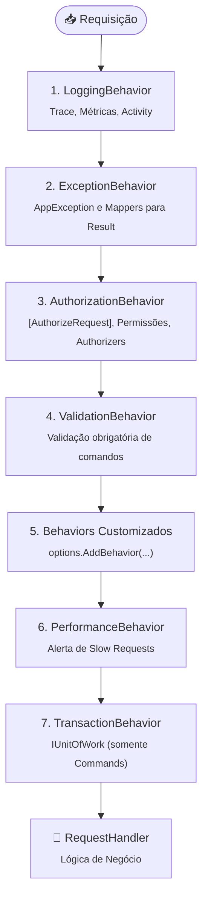

[🏛️ TEC.Cqrs](../../README.md) ➔ [📖 Documentação](../README.md) ➔ [ADRs](README.md) ➔ ADR-0003

# ADR-0003: Pipeline Estrito de Behaviors, Ordem Determinística e Defesa em Profundidade

## Status
`Aceito`

## Contexto e Problema
O padrão *Pipeline Behaviors* (decoradores em cadeia ao redor do handler) é o coração de um mediator moderno. No entanto, em bibliotecas onde a ordem de registro é desregulada ou delegada ao acaso do contêiner de injeção de dependência, emergem graves falhas de segurança e integridade:
1. **Validação Antes de Autorização (Vazamento de Regras):** Se a validação executar antes da autorização, um invasor não autenticado ou não autorizado pode submeter payloads hostis para sondar regras de negócio internas e restrições de banco antes de ser rejeitado.
2. **Behaviors Customizados Externos ao Logging:** Se um behavior customizado for registrado fora do logging ou da captura de exceções, falhas ocorridas nele tornam-se cegas para a telemetria e o rastreamento distribuído.
3. **Transação Aberta Prematuramente:** Se a transação de banco for aberta antes da autorização ou da validação, recursos caros de conexão e locks de banco de dados são consumidos por requisições inválidas que serão imediatamente descartadas.

O livro **CQRS na Prática** (*Capítulo 08: Pipeline behaviors* e *Capítulo 22: Segurança em aplicações CQRS*) enfatiza o princípio de defesa em profundidade e a necessidade de ordem imutável no pipeline.

## Decisão
Estabeleceu-se uma **ordem estrita, imutável e verificada no boot** para os comportamentos do pipeline:

1. **Defesa em Profundidade:**
   - **Logging & Métricas (Externo):** Toda requisição tem início, desfecho e duração mensurados uniformemente.
   - **Autorização Antes da Validação:** Usuários não autenticados ou não autorizados recebem 401/403 imediatamente, sem que o validador execute e sem revelar mensagens de erro ou regras de domínio a atores maliciosos.
   - **Transação Logo Antes do Handler:** Conexões com banco de dados e transações do `IUnitOfWork` só são abertas se e somente se o comando passou com sucesso irrestrito por autorização, validação e behaviors customizados.
2. **Proteção Contra Registro Fora de Ordem (`EnsureNoBehaviorsRegisteredBefore`):**
   - É terminantemente proibido registrar `IPipelineBehavior<,>` diretamente no container antes de invocar `services.AddTecCqrs(...)`. O container valida isso na inicialização e lança `InvalidOperationException`.

## Consequências

### Positivas
- **Segurança Blindada:** Regras de negócio e estruturas de dados não são expostas a agentes não autorizados.
- **Eficiência de Recursos:** Nenhuma transação ou lock de banco de dados é alocado para requisições inválidas.
- **Rastreabilidade Universal:** Todo behavior customizado da aplicação opera sob a égide do logging e do contexto assíncrono.

### Negativas / Limitações
- **Flexibilidade Controlada:** Desenvolvedores não podem reordenar os behaviors nativos do núcleo (ex.: mover transação para fora da validação). Essa restrição é intencional para garantir solidez arquitetural.

## Referências
- Livro *CQRS na Prática*, Capítulo 08: *Pipeline behaviors*.
- Livro *CQRS na Prática*, Capítulo 22: *Segurança em aplicações CQRS*.
- Código: `TEC.Cqrs.DependencyInjection.ServiceCollectionExtensions`, `TEC.Cqrs.Behaviors.*`.
