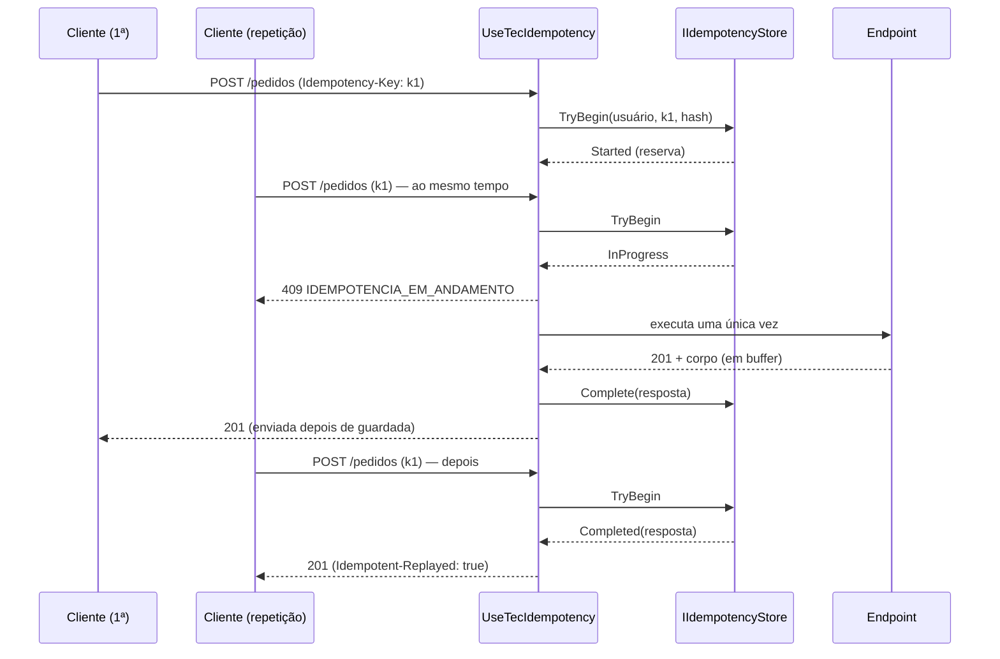

[🏠 TEC.Cqrs](../README.md) › [📚 Documentação](README.md) › Idempotência

# 🔁 Idempotência

> Repetir um `POST` com o mesmo `Idempotency-Key` devolve a resposta original sem criar de novo, mesmo com requisições simultâneas.

## 📑 Sumário

- [🎯 Visão geral](#-visão-geral)
- [🚀 Uso](#-uso)
  - [Registrar](#registrar)
  - [Marcar endpoints](#marcar-endpoints)
  - [Escolher o store](#escolher-o-store)
  - [Store em memória: limites e despejo](#store-em-memória-limites-e-despejo)
  - [Store próprio](#store-próprio)
- [⚙️ Opções](#️-opções)
- [❌ Erros](#-erros)
- [🛡️ Segurança](#️-segurança)
- [❓ Perguntas frequentes](#-perguntas-frequentes)

---

## 🎯 Visão geral

| Tipo | Pacote | Para que serve |
|---|---|---|
| `IIdempotencyStore` | `TEC.Cqrs` (`TEC.Cqrs.Idempotency`) | Reserva a chave, guarda e devolve a resposta |
| `InMemoryIdempotencyStore` / `AddInMemoryIdempotencyStore()` | `TEC.Cqrs` | Store em memória (uma instância, testes) |
| `EfIdempotencyStore<TContext>` / `AddTecOrmIdempotency<TContext>()` | `TEC.ORM.EntityFrameworkCore` (o `AddTecOrmIdempotency` também existe no `TEC.ORM.SqlServer`) | Store no banco (várias instâncias) |
| `.AddIdempotency()` / `IdempotencyOptions` | `TEC.Cqrs.AspNetCore` (`TEC.Cqrs.AspNetCore.Idempotency`) | Configuração |
| `app.UseTecIdempotency()` | `TEC.Cqrs.AspNetCore` | Middleware |
| `.WithIdempotency()` / `[Idempotent]` | `TEC.Cqrs.AspNetCore` | Marca o endpoint |



Regras:

| Situação | Resposta |
|---|---|
| Chave nova | Executa; guarda a resposta **2xx** (com `Location`, `ETag`...) |
| Mesma chave e mesmo conteúdo, concluída | Devolve a resposta guardada + `Idempotent-Replayed: true` (não executa) |
| Mesma chave, outra execução em andamento | **409** `IDEMPOTENCIA_EM_ANDAMENTO` (tente de novo em instantes) |
| Mesma chave com outro conteúdo (método, caminho, query, corpo ou cabeçalhos de `HashedRequestHeaders`) | **422** `IDEMPOTENCY_KEY_REUTILIZADA` |
| Resposta não 2xx, ou exceção antes de qualquer efeito (sem transação confirmada e sem resposta 2xx escrita) | Não guarda e **libera** a chave (o cliente pode tentar de novo) |
| Resposta não 2xx depois de um command confirmar a transação do pipeline, ou exceção depois do commit ou de uma resposta 2xx já escrita | Não guarda e **mantém** a reserva até o `LockTimeout` (a operação teve efeito): a repetição recebe 409 até lá |
| Cliente desconecta depois da resposta 2xx | A resposta já foi guardada antes do envio: a repetição recebe a resposta guardada |
| Cliente desconecta e o endpoint é cancelado (`OperationCanceledException`) depois de a operação ter efeito: transação do pipeline confirmada ou resposta 2xx já escrita | A reserva é **mantida** até o `LockTimeout`: a repetição recebe 409 até lá |
| Cliente desconecta e o endpoint é cancelado antes de qualquer efeito (sem commit e sem bytes de resposta 2xx; o status 2xx sozinho não conta) | Não guarda e **libera** a chave: a repetição executa |
| O store falha ao guardar a resposta 2xx | Mais 2 tentativas (esperas de 50 e 200 ms). Se todas falharem, a resposta vai ao cliente assim mesmo, a reserva fica até o `LockTimeout` e o evento 1027 é registrado |
| Requisição sem usuário identificado, cabeçalho opcional | Executa **sem** idempotência (não há escopo seguro); aviso em log se o usuário estiver autenticado sem claim de id |
| Requisição sem usuário identificado, `keyRequired` | **401** para o anônimo; **500** `IDEMPOTENCIA_SEM_ESCOPO` para o usuário autenticado sem claim de id (erro de configuração). Não executa |

A chave vale **por usuário**: o escopo é o SHA-256 do tipo, do emissor e do valor do primeiro claim de `UserIdClaimTypes`
(`tec_uid`, `oid`, `NameIdentifier` ou `sub`) encontrado numa identidade **autenticada**. A mesma chave de outro usuário — ou
do mesmo valor de id vindo de outro esquema de autenticação (outro tipo de claim ou emissor) — não devolve a resposta de
ninguém. Em aplicações multi-tenant em que o tenant não faz parte do usuário, informe-o em `ScopeDiscriminator`.

> [!NOTE]
> A resposta do endpoint idempotente fica em **buffer** (até `MaxResponseBodyBytes`) e só é enviada ao cliente depois de
> guardada: a desconexão do cliente não faz a chave ser liberada nem a operação ser executada de novo. Respostas maiores que o
> limite passam a ser enviadas direto (streaming) e não são guardadas.

---

## 🚀 Uso

### Registrar

```csharp
builder.Services.AddTecCqrs(o => o.RegisterServicesFromAssemblyContaining<Program>())
    .AddAspNetCore()
    .AddIdempotency(o => o.Retention = TimeSpan.FromHours(24));

builder.Services.AddTecOrmIdempotency<AppDbContext>();   // ou AddInMemoryIdempotencyStore()

var app = builder.Build();
app.UseTecExceptionHandler();
app.UseAuthentication();
app.UseAuthorization();
app.UseTecIdempotency();   // depois da autenticação: o escopo é o usuário
```

### Marcar endpoints

```csharp
app.MapPost("/pedidos", (CriarPedidoCommand c, ISender s, CancellationToken ct) =>
        s.Send(c, ct).ToCreatedHttpResult(id => $"/pedidos/{id}"))
   .WithIdempotency();                 // cabeçalho opcional

app.MapPost("/pagamentos", ...).WithIdempotency(keyRequired: true);   // sem cabeçalho: 400

// Controllers
[HttpPost, Idempotent(KeyRequired = true)]
public Task<IActionResult> Pagar(PagarCommand command) => ...;
```

Também funciona em grupos: `app.MapGroup("/api").WithIdempotency()`.

### Escolher o store

| Store | Quando usar |
|---|---|
| `AddInMemoryIdempotencyStore()` | Testes, desenvolvimento, uma única instância. Limites: `MaxEntries` (padrão 10.000), `MaxEntriesPerScope` (padrão 1.000) e `MaxTotalBytes` (padrão 256 MiB). Veja [o despejo do store em memória](#store-em-memória-limites-e-despejo) |
| `AddTecOrmIdempotency<TContext>()` (TEC.ORM) | Produção com várias instâncias: reserva atômica no banco, limpeza periódica |

### Store em memória: limites e despejo

| Opção (`InMemoryIdempotencyStoreOptions`) | Padrão | Descrição |
|---|---|---|
| `MaxEntries` | 10.000 | Máximo de chaves guardadas no total |
| `MaxEntriesPerScope` | 1.000 | Máximo de chaves por escopo (usuário) |
| `MaxTotalBytes` | 256 MiB | Orçamento das respostas guardadas: corpo mais o texto do content type e dos cabeçalhos, a 2 bytes por caractere |

Os três são validados no `AddInMemoryIdempotencyStore` (valor menor que 1: `ArgumentOutOfRangeException` na subida).
Quando falta espaço, o store descarta primeiro as entradas expiradas, de qualquer escopo, e depois as respostas
concluídas **do próprio escopo** de quem está pedindo, das que expiram primeiro. Reservas em andamento nunca saem.

Respostas ainda válidas de **outros** escopos também nunca saem. Descartá-las abriria espaço, mas a repetição do outro
usuário executaria a operação de novo sem ninguém perceber (o problema que a idempotência existe para evitar). Sem espaço
depois do despejo permitido, o store falha fechado com `InvalidOperationException`:

- em `TryBeginAsync` (limite de entradas, ou `MaxTotalBytes` já esgotado), antes de executar a operação: a requisição
  recebe 500 e nada é executado;
- em `CompleteAsync`, se a resposta não couber no orçamento: o middleware tenta de novo, envia a resposta ao cliente e a
  reserva fica em andamento até o `LockTimeout` (evento 1027).

Dimensione os limites para o pico de usuários ativos na janela de `Retention`. Com muitas recusas, a saída é aumentar os
limites, reduzir `Retention`/`MaxResponseBodyBytes` ou usar um store compartilhado.

### Store próprio

Implemente `IIdempotencyStore` (ex.: Redis com `SET NX PX`). Contrato:

- `TryBeginAsync` é **atômico** por chave: só uma chamada recebe `Started`; reserva expirada (`LockTimeout`) pode ser assumida;
- `CompleteAsync`/`AbandonAsync` só valem com o `LockId` vigente (devolvem `false` caso contrário);
- resposta concluída expira em `Retention`;
- escopo e chave comparados de forma **ordinal** (`Pedido-1` ≠ `pedido-1`): em banco, use collation binária nas colunas
  (ex.: `Latin1_General_100_BIN2`), não a collation padrão (em geral, insensível a maiúsculas);
- chave não inicializada (`default(IdempotencyKey)`) é rejeitada com `ArgumentException` (`IdempotencyRequest.Validate()` já
  verifica o pedido).

> [!NOTE]
> O `EfIdempotencyStore` do TEC.ORM (`TEC.ORM.EntityFrameworkCore`) já usa a collation binária `Latin1_General_100_BIN2` nas colunas
> `Scope`/`IdempotencyKey`, com o mesmo comportamento ordinal do store em memória.

---

## ⚙️ Opções

`IdempotencyOptions`, validadas na inicialização (`ValidateOnStart`):

| Opção | Padrão | Descrição |
|---|---|---|
| `HeaderName` | `Idempotency-Key` | Cabeçalho da chave |
| `ReplayedHeaderName` | `Idempotent-Replayed` | Cabeçalho das respostas repetidas |
| `MaxKeyLength` | 100 | Tamanho máximo da chave (até 200) |
| `MaxRequestBodyBytes` | 1 MiB | Corpo maior: **413** sem executar |
| `MaxResponseBodyBytes` | 1 MiB | Resposta maior é enviada, mas não guardada (chave liberada, aviso em log) |
| `Retention` | 24 h | Tempo de guarda da resposta |
| `LockTimeout` | 2 min | Prazo da reserva (maior que o tempo máximo de uma requisição) |
| `StoredResponseHeaders` | `Location`, `ETag`, `Content-Location`, `Last-Modified` | Cabeçalhos repetidos |
| `UserIdClaimTypes` | `tec_uid`, `oid` (URI e curto), `NameIdentifier`, `sub` | Claims do escopo, em ordem (só de identidades autenticadas) |
| `ScopeDiscriminator` | `null` | Complemento do escopo além do usuário (ex.: tenant de um cabeçalho ou claim) |
| `HashedRequestHeaders` | nenhum | Cabeçalhos incluídos no hash do conteúdo (outro valor com a mesma chave: 422) |

```csharp
.AddIdempotency(o =>
{
    o.ScopeDiscriminator = context => context.User.FindFirst("tenant_id")?.Value;
    o.HashedRequestHeaders.Add("X-Api-Version");
});
```

## ❌ Erros

| Código | HTTP | Quando ocorre | O que fazer |
|---|---|---|---|
| `IDEMPOTENCY_KEY_OBRIGATORIA` | 400 | Endpoint com `keyRequired` sem o cabeçalho | Envie a chave (ex.: um GUID por operação) |
| `IDEMPOTENCY_KEY_INVALIDA` | 400 | Vários valores (inclusive com o primeiro vazio), só espaços, longa demais ou com caracteres de controle | Envie um único valor curto |
| `NAO_AUTENTICADO` | 401 | Endpoint com `keyRequired` chamado sem usuário autenticado | Autentique-se |
| `IDEMPOTENCIA_SEM_ESCOPO` | 500 | Endpoint com `keyRequired` e usuário autenticado sem nenhum dos `UserIdClaimTypes` (ex.: API key) | Inclua o claim do esquema em `UserIdClaimTypes` |
| `IDEMPOTENCIA_CORPO_EXCEDE_LIMITE` | 413 | Corpo maior que `MaxRequestBodyBytes` | Aumente o limite ou reduza o corpo |
| `IDEMPOTENCIA_EM_ANDAMENTO` | 409 | Outra requisição com a chave ainda executa | Tente de novo depois de alguns segundos |
| `IDEMPOTENCY_KEY_REUTILIZADA` | 422 | Mesma chave com outro conteúdo | Gere uma chave nova por operação |
| `InvalidOperationException` | — | `UseTecIdempotency` sem `AddIdempotency` ou sem `IIdempotencyStore`; `AddIdempotency` duas vezes | Corrija o registro |

## 🛡️ Segurança

> [!WARNING]
> Registre o `UseTecIdempotency` **depois** de `UseAuthentication`. Antes, nenhuma requisição teria usuário e a idempotência seria ignorada.

> [!WARNING]
> A resposta guardada é devolvida a quem repetir a chave **do mesmo usuário**. Não marque como idempotentes endpoints cuja resposta muda conforme permissões que podem ser revogadas no intervalo de `Retention` sem considerar esse efeito.

- A chave e o corpo nunca vão para o log; o store guarda o hash do escopo, não o id do usuário.
- Limites de corpo (requisição e resposta) evitam uso do store como depósito de dados. No store em memória, nenhum
  usuário descarta as respostas guardadas dos outros: nem pela cota por escopo, nem no limite total, nem no orçamento de
  bytes.
- O store em memória limita a quantidade de entradas e os bytes (`MaxTotalBytes`, padrão 256 MiB). Sem o orçamento, o pior
  caso com os padrões (10.000 entradas, até 1 MiB cada) chegaria a cerca de 10 GiB.
- O log de falha ao guardar a resposta (1026/1027) leva só o tipo da exceção: nem a chave, nem o corpo, nem a mensagem da
  exceção do store (que pode trazer detalhes de conexão).
- O hash inclui método, caminho, query, os cabeçalhos de `HashedRequestHeaders` e o corpo (SHA-256).
- Claims de identidades não autenticadas do principal não definem o escopo.
- `keyRequired` é garantia: o endpoint não executa sem reserva.

## ❓ Perguntas frequentes

<details>
<summary><b>E se o processo cair no meio da execução?</b></summary>

A reserva expira em `LockTimeout`; depois disso, a próxima requisição com a chave executa. Se a primeira tentar concluir depois, `CompleteAsync` devolve `false` e um aviso é registrado (não sobrescreve).
</details>

<details>
<summary><b>E se o cliente desistir (timeout) antes de receber a resposta?</b></summary>

Se o endpoint terminou, a resposta já foi guardada antes do envio: a repetição recebe a resposta original
(`Idempotent-Replayed: true`). Se o endpoint foi interrompido pelo cancelamento (`OperationCanceledException`), a decisão
depende do que já foi efetivado:

- transação do pipeline confirmada, ou resposta 2xx já escrita (bytes no buffer ou já enviados): a reserva fica até o
  `LockTimeout` (repetições recebem 409) e o evento 1023 é registrado;
- nada disso: a chave é liberada e a repetição executa. O `Response.StatusCode` sozinho não conta, porque começa em 200 e
  o endpoint pode defini-lo antes de executar a operação.

Um endpoint que grava sem a transação do pipeline e é cancelado antes de escrever a resposta não deixa sinal de efeito:
a chave é liberada. Nesse caso, use a transação do pipeline (`IUnitOfWork`) ou trate o cancelamento no próprio endpoint.
`ToHttpResult`/`ToCreatedHttpResult` não cancelam a escrita da resposta.
</details>

<details>
<summary><b>E se o store falhar ao guardar a resposta?</b></summary>

Se `CompleteAsync` lançar exceção (ex.: banco instável), o middleware tenta de novo mais 2 vezes, com esperas de 50 e
200 ms (evento 1026 a cada falha). Se todas falharem, a resposta é enviada ao cliente assim mesmo (a operação já foi
executada) e o evento 1027 é registrado. A reserva fica até o `LockTimeout`; depois desse prazo, a repetição com a mesma
chave executa a operação de novo. Use um store com a mesma disponibilidade do banco da operação e um `LockTimeout` que
cubra a recuperação esperada.
</details>

<details>
<summary><b>Isto substitui a idempotência dos consumidores de fila?</b></summary>

Não. Para mensagens, use o Inbox do TEC.Messaging (deduplicação por `MessageId` na mesma transação do efeito).
</details>

---

⬅️ [🌐 ASP.NET Core](aspnetcore.md) · [📚 Índice](README.md) · [📈 Observabilidade](observabilidade.md) ➡️
